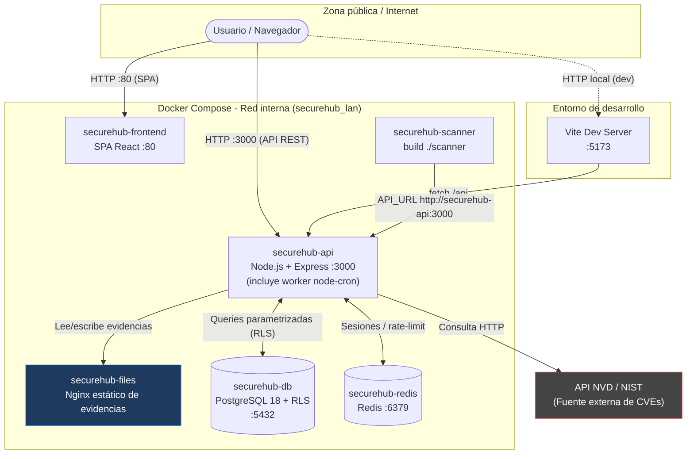
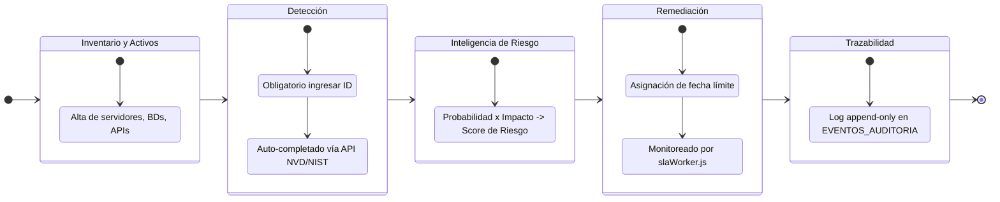
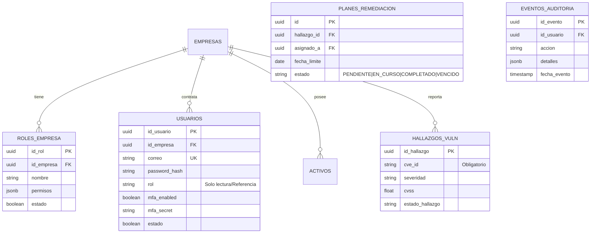

# VulnTrack — Plataforma DevSecOps de Gestión Integral de Vulnerabilidades (VAM)


> Desarrollado por el equipo de Seguridad y DevSecOps.

**VulnTrack** es una plataforma para el seguimiento y remediación de vulnerabilidades informáticas, orientada a entornos corporativos **multi-tenant**. No es un antivirus ni un escáner estático: es el panel centralizado que unifica el inventario de activos, los hallazgos de seguridad (enriquecidos automáticamente desde la base nacional de vulnerabilidades del NIST/NVD), el análisis de riesgo y los planes de remediación con SLAs monitoreados de forma automatizada.

El flujo operativo sigue una secuencia estricta:

**[Inventario y Detección] → [Cálculo de Riesgo / Inteligencia] → [Remediación y Cierre]**

> **Nota del mantenedor**: El logo superior es el placeholder por defecto de Vite. Reemplázalo por un banner propio antes de publicar el repositorio en producción.

---

## Tabla de contenidos

1. [Stack Tecnológico](#stack-tecnológico)
2. [Arquitectura del Sistema](#arquitectura-del-sistema)
3. [Flujo Operativo y de Negocio](#flujo-operativo-y-de-negocio)
4. [Modelo Relacional de Datos (ERD)](#modelo-relacional-de-datos-erd)
5. [Control de Acceso Basado en Permisos (RBAC Dinámico)](#control-de-acceso-basado-en-permisos-rbac-dinámico)
6. [Prerrequisitos](#prerrequisitos)
7. [Variables de Entorno](#variables-de-entorno)
8. [Instrucciones de Despliegue Local](#instrucciones-de-despliegue-local)
9. [Solución de Problemas Comunes](#solución-de-problemas-comunes)
10. [Cuentas de Prueba](#cuentas-de-prueba)
11. [Postura de Seguridad y Checklist OWASP](#postura-de-seguridad-y-checklist-owasp)

---

## Stack Tecnológico

Los nombres entre paréntesis corresponden a los servicios reales definidos en `docker-compose.yml`.

| Capa | Tecnología | Servicio compose | Rol en el proyecto |
|---|---|---|---|
| Frontend | React + Vite, Tailwind CSS, Lucide React | `securehub-frontend` (`:80`) | SPA publicada directamente en el puerto `80`; hot-reload en desarrollo con Vite, build optimizado en producción. |
| Backend | Node.js + Express | `securehub-api` (`:3000`) | API REST, lógica de negocio y enrutamiento. |
| Base de datos | PostgreSQL 18 (`postgres:18.6-alpine`) | `securehub-db` | Datos relacionales y **Row-Level Security (RLS)** para aislamiento estricto multi-tenant. |
| Caché / Mensajería | Redis 7 | `securehub-redis` | Almacenamiento rápido de sesiones. *(Nota: Preparado para escalarse con middlewares de rate-limiting)*. |
| Servidor de evidencias | Nginx (`nginx:alpine`) | `securehub-files` | Sirve **únicamente** las evidencias estáticas (volumen `files-data` montado en `/usr/share/nginx/html/evidencias`). Según `config/nginx.conf` solo permite `GET`/`HEAD` sin listado de directorios. **No** termina TLS ni actúa como reverse proxy que enrute la API. |
| Escáner | Imagen propia (`build ./scanner`) | `securehub-scanner` | Proceso que consulta la API vía `API_URL=http://securehub-api:3000` para su trabajo de escaneo. |
| Automatización | `node-cron` | *(hilo interno de `securehub-api`)* | Hilo asíncrono integrado (`slaWorker.js`) para el monitoreo automatizado de vencimientos de SLA. No es un contenedor separado. |
| Autenticación | `jsonwebtoken`, `bcryptjs`, `speakeasy` + `qrcode` | *(parte de `securehub-api`)* | JWT stateless, hashing robusto de contraseñas con salt automático, MFA/TOTP compatible con Google Authenticator. |
| Contenerización | Docker + Docker Compose | — | Orquestación local de todos los servicios anteriores. |

---

## Arquitectura del Sistema

La arquitectura aísla completamente a las empresas a nivel de base de datos mediante RLS (Row Level Security). Las tareas asíncronas se gestionan mediante un hilo `node-cron` integrado en la propia API (no hay contenedor de worker separado). El cliente accede **directamente** a dos servicios expuestos: el frontend en el puerto `80` (`securehub-frontend`) y la API en el puerto `3000` (`securehub-api`). No existe un reverse proxy que termine TLS ni que enrute la API; el servicio Nginx (`securehub-files`) solo sirve evidencias estáticas dentro de la red interna.



> **Endpoint de salud:** `GET /health` responde `{ status: 'OK', servicio: 'SecureHub API', version: '1.0.0' }`, útil para healthchecks y verificación rápida de que la API está en línea.

---

## Flujo Operativo y de Negocio



---

## Modelo Relacional de Datos (ERD)

VulnTrack aísla de forma matemática a las empresas utilizando **Políticas RLS en PostgreSQL**. Además, cuenta con una tabla de roles dinámica por inquilino.



---

## Control de Acceso Basado en Permisos (RBAC Dinámico)

A diferencia de los sistemas tradicionales, VulnTrack no utiliza roles "quemados" (hardcoded). Implementa un motor dinámico:
1. El Administrador crea roles personalizados y les asigna permisos granulares (JSONB) en la tabla `roles_empresa`.
2. Al iniciar sesión, la matriz de permisos se empaqueta criptográficamente en el JWT.
3. El middleware en Node.js valida la existencia del permiso exacto antes de permitir la ejecución.


---

## Prerrequisitos

Antes de clonar, verifica tener instaladas las siguientes herramientas:

| Herramienta | Comando de verificación | Notas |
|---|---|---|
| Docker | `docker --version` | Necesario para levantar DB, Redis y API localmente. |
| Docker Compose | `docker-compose version` | Verifica tu versión (standalone o plugin). |
| Node.js | `node -v` | (v18+) Necesario para correr el frontend (`npm run dev`). |
| Puertos | Verificar `3000`, `5432`, `5173` libres | Libera los puertos locales si tienes otros proyectos activos. |

---

## Variables de Entorno

Debes crear un archivo `.env` en la **raíz del proyecto** (junto a `docker-compose.yml`), partiendo de la plantilla `.env.example` incluida en esa misma raíz.

| Variable | Propósito | Notas de seguridad |
|---|---|---|
| `DB_HOST`, `DB_USER` | Credenciales del superusuario de la DB | El superusuario crea la base; evita usarlo para la operación normal de la API. |
| `DB_APP_USER` | Cuenta de bajo privilegio que usa la API | Debe existir en `init.sql`. Garantiza que las políticas RLS apliquen; sin permisos para crear/eliminar tablas. |
| `DB_APP_PASSWORD` | Contraseña de la cuenta `DB_APP_USER` | Nunca hardcodear. Distinta de la del superusuario. |
| `CORS_ORIGINS` | Lista CSV de orígenes permitidos por CORS | En producción, restringir a los dominios reales del frontend (p. ej. `http://localhost:5173,http://localhost`). |
| `REDIS_HOST` | Host del contenedor Redis | En docker-compose apunta al servicio `securehub-redis`. |
| `JWT_SECRET` | Firma criptográfica JWT | Nunca hardcodear en código fuente. Usar una cadena larga y aleatoria. |
| `NVD_API_KEY` | API Key de NIST (Opcional) | Evita bloqueos por Rate-Limit en la ingesta de CVEs. |

---

## Instrucciones de Despliegue Local
 
1. **Clonar el repositorio:**
```bash
   git clone <repo-url> VulnTrack
   cd VulnTrack
```
 
2. **Configurar variables de entorno:**
```bash
   cp .env.example .env
   # Edita .env con tus valores locales antes de continuar
```
 
3. **Levantar la infraestructura base (Docker):**
```bash
   docker compose up -d --build
```
   Esto aprovisiona PostgreSQL (`securehub-db`), Redis (`securehub-redis`), el servidor de evidencias (`securehub-files`), el escáner (`securehub-scanner`), la API (`securehub-api`, que incluye el hilo `node-cron`) y el frontend (`securehub-frontend`). El servicio `securehub-api` ya declara `depends_on` con `condition: service_healthy` sobre `securehub-db` y `securehub-redis` — así la API no arranca antes de que Postgres y Redis estén listos para aceptar conexiones.
 
4. **Confirmar que todos los contenedores están arriba:**
```bash
   docker compose ps
```
   Todos los servicios deben mostrar estado `running` (o `healthy` si definiste healthchecks).
 
5. **Iniciar el entorno de desarrollo frontend (Hot-Reload):**
```bash
   cd frontend
   npm install
   npm run dev
```
   Abre el panel en: `http://localhost:5173`
 
6. **(Opcional) Ver logs en vivo de un servicio específico**, por ejemplo la API, para confirmar que el cron job del worker interno corre:
```bash
   docker compose logs -f securehub-api
```
   El worker `node-cron` (`slaWorker.js`) se ejecuta dentro de `securehub-api`, por lo que no existe un servicio `worker` separado al que consultar.
*Abre el panel en: `http://localhost:5173`*

---

## Solución de Problemas Comunes

| Síntoma | Causa probable | Solución |
|---|---|---|
| Crash `pool.connect is not a function` en logs del API | La destructuración del archivo `db.js` falló en el SLA worker. | (Ya resuelto en v1.1). Verificar que se importa usando `const { pool } = require(...)`. |
| Menú de "Rol Inicial" aparece vacío | Faltan permisos de base de datos para la tabla `roles_empresa`. | Ejecutar `GRANT ALL PRIVILEGES ON TABLE roles_empresa TO app_user;` en PostgreSQL. |
| "Objects are not valid as a React child" en el Dashboard | Se intentó renderizar un JSON puro (la columna `detalles`) en React. | (Ya resuelto). Se debe mapear `notif.accion` en la interfaz. |
| Cierre de sesión (Logout) bloqueado | Política de MFA forzado. | Se debe escanear el QR e ingresar el PIN al menos una vez para habilitar la salida. |

---

## Cuentas de Prueba

Las bases de datos incluyen un seed inicial con la empresa ACME Corp y tres usuarios de prueba. Los roles son totalmente editables desde el panel:

| Correo | Rol Asignado |
|---|---|
| `admin@acme.com` | **ADMINISTRADOR** (Permiso "ALL") |
| `auditor@acme.com` | **AUDITOR** (Ver activos, Ver/Crear Vulnerabilidades) |
| `dev@acme.com` | **REMEDIADOR** (Acceso a planes de acción) |

**Nota de Seguridad (MFA):** Durante el primer inicio de sesión, el doble factor estará inactivo. El sistema forzará de manera estricta la configuración del MFA en cuanto el usuario intente desloguearse (Cerrar Sesión).

---

## Postura de Seguridad y Checklist OWASP

Este proyecto nace bajo un enfoque *Security-by-Design*:

| Categoría OWASP Top 10 (2021) | Contramedida Implementada y Verificada |
|---|---|
| **A01 – Broken Access Control** | RLS activo en Postgres; Middleware de permisos dinámicos en Node; Soft-Deletes. |
| **A02 – Cryptographic Failures** | `bcryptjs` con generador de sal automático para credenciales. JWT firmado correctamente. |
| **A03 – Injection** | Consultas estrictamente parametrizadas con `pg`. Prevención absoluta de SQLi. |
| **A04 – Insecure Design** | El `app_user` no tiene permisos para crear/eliminar tablas. Modelo Multi-tenant rígido. |
| **A07 – Auth Failures** | Expiración de JWT. Imposición mandatoria de MFA (TOTP) al salir. |
| **A09 – Security Logging** | Tabla inmutable `EVENTOS_AUDITORIA` que registra intentos exitosos, creaciones, 401 y 403. |
