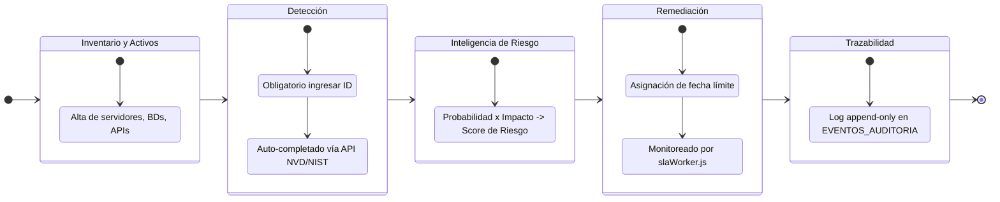
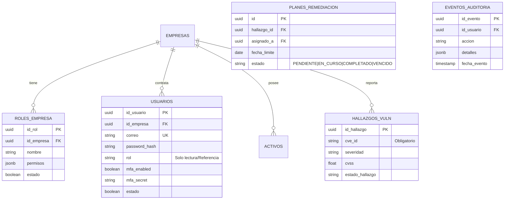
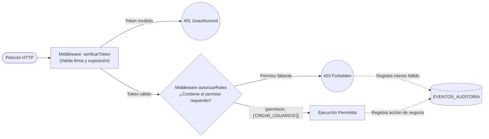

# VulnTrack — Plataforma DevSecOps de Gestión Integral de Vulnerabilidades (VAM)


> Desarrollado por el equipo de Seguridad y DevSecOps.

**VulnTrack** es una plataforma para el seguimiento y remediación de vulnerabilidades informáticas, orientada a entornos corporativos **multi-tenant**. No es un antivirus ni un escáner estático: es el panel centralizado que unifica el inventario de activos, los hallazgos de seguridad (enriquecidos automáticamente desde la base nacional de vulnerabilidades del NIST/NVD), el análisis de riesgo y los planes de remediación con SLAs monitoreados de forma automatizada.

El flujo operativo sigue una secuencia estricta:

**[Inventario y Detección] → [Cálculo de Riesgo / Inteligencia] → [Remediación y Cierre]**

> **Nota del mantenedor**: El logo superior es el placeholder por defecto de Vite. Reemplázalo por un banner propio antes de publicar el repositorio en producción.

---

## Tabla de contenidos

1. [Stack Tecnológico](#stack-tecnológico)
2. [Arquitectura del Sistema](#arquitectura-del-sistema)
3. [Flujo Operativo y de Negocio](#flujo-operativo-y-de-negocio)
4. [Modelo Relacional de Datos (ERD)](#modelo-relacional-de-datos-erd)
5. [Control de Acceso Basado en Permisos (RBAC Dinámico)](#control-de-acceso-basado-en-permisos-rbac-dinámico)
6. [Prerrequisitos](#prerrequisitos)
7. [Variables de Entorno](#variables-de-entorno)
8. [Instrucciones de Despliegue Local](#instrucciones-de-despliegue-local)
9. [Solución de Problemas Comunes](#solución-de-problemas-comunes)
10. [Cuentas de Prueba](#cuentas-de-prueba)
11. [Postura de Seguridad y Checklist OWASP](#postura-de-seguridad-y-checklist-owasp)

---

## Stack Tecnológico

Los nombres entre paréntesis corresponden a los servicios reales definidos en `docker-compose.yml`.

| Capa | Tecnología | Servicio compose | Rol en el proyecto |
|---|---|---|---|
| Frontend | React + Vite, Tailwind CSS, Lucide React | `securehub-frontend` (`:80`) | SPA publicada directamente en el puerto `80`; hot-reload en desarrollo con Vite, build optimizado en producción. |
| Backend | Node.js + Express | `securehub-api` (`:3000`) | API REST, lógica de negocio y enrutamiento. |
| Base de datos | PostgreSQL 18 (`postgres:18.6-alpine`) | `securehub-db` | Datos relacionales y **Row-Level Security (RLS)** para aislamiento estricto multi-tenant. |
| Caché / Mensajería | Redis 7 | `securehub-redis` | Almacenamiento rápido de sesiones y contadores del rate-limiting anti fuerza bruta del login (`middlewares/rateLimitLogin.js`), con degradación *fail-open* si Redis no está disponible. |
| Servidor de evidencias | Nginx (`nginx:alpine`) | `securehub-files` | Sirve **únicamente** las evidencias estáticas (volumen `files-data` montado en `/usr/share/nginx/html/evidencias`). Según `config/nginx.conf` solo permite `GET`/`HEAD` sin listado de directorios. **No** termina TLS ni actúa como reverse proxy que enrute la API. |
| Escáner | Imagen propia (`build ./scanner`) | `securehub-scanner` | Proceso que consulta la API vía `API_URL=http://securehub-api:3000` para su trabajo de escaneo. |
| Automatización | `node-cron` | *(hilo interno de `securehub-api`)* | Hilo asíncrono integrado (`slaWorker.js`) para el monitoreo automatizado de vencimientos de SLA. No es un contenedor separado. |
| Autenticación | `jsonwebtoken`, `bcryptjs`, `speakeasy` + `qrcode` | *(parte de `securehub-api`)* | JWT stateless, hashing robusto de contraseñas con salt automático, MFA/TOTP compatible con Google Authenticator. |
| Contenerización | Docker + Docker Compose | — | Orquestación local de todos los servicios anteriores. |

---

## Arquitectura del Sistema

La arquitectura aísla completamente a las empresas a nivel de base de datos mediante RLS (Row Level Security). Las tareas asíncronas se gestionan mediante un hilo `node-cron` integrado en la propia API (no hay contenedor de worker separado). El cliente accede **directamente** a dos servicios expuestos: el frontend en el puerto `80` (`securehub-frontend`) y la API en el puerto `3000` (`securehub-api`). No existe un reverse proxy que termine TLS ni que enrute la API; el servicio Nginx (`securehub-files`) solo sirve evidencias estáticas dentro de la red interna.


> **Endpoint de salud:** `GET /health` responde `{ status: 'OK', servicio: 'SecureHub API', version: '1.0.0' }`, útil para healthchecks y verificación rápida de que la API está en línea.

---

## Flujo Operativo y de Negocio



---

## Modelo Relacional de Datos (ERD)

VulnTrack aísla de forma matemática a las empresas utilizando **Políticas RLS en PostgreSQL**. Además, cuenta con una tabla de roles dinámica por inquilino.



---

## Control de Acceso Basado en Permisos (RBAC Dinámico)

A diferencia de los sistemas tradicionales, VulnTrack no utiliza roles "quemados" (hardcoded). Implementa un motor dinámico:
1. El Administrador crea roles personalizados y les asigna permisos granulares (JSONB) en la tabla `roles_empresa`.
2. Al iniciar sesión, la matriz de permisos se empaqueta criptográficamente en el JWT.
3. El middleware en Node.js valida la existencia del permiso exacto antes de permitir la ejecución.



---

## Prerrequisitos

Antes de clonar, verifica tener instaladas las siguientes herramientas:

| Herramienta | Comando de verificación | Notas |
|---|---|---|
| Docker | `docker --version` | Necesario para levantar DB, Redis y API localmente. |
| Docker Compose | `docker-compose version` | Verifica tu versión (standalone o plugin). |
| Node.js | `node -v` | (v18+) Necesario para correr el frontend (`npm run dev`). |
| Puertos | Verificar `3000`, `5432`, `5173` libres | Libera los puertos locales si tienes otros proyectos activos. |

---

## Variables de Entorno

Debes crear un archivo `.env` en la **raíz del proyecto** (junto a `docker-compose.yml`), partiendo de la plantilla `.env.example` incluida en esa misma raíz.

| Variable | Propósito | Notas de seguridad |
|---|---|---|
| `DB_HOST`, `DB_USER` | Credenciales del superusuario de la DB | El superusuario crea la base; evita usarlo para la operación normal de la API. |
| `DB_APP_USER` | Cuenta de bajo privilegio que usa la API | Debe existir en `init.sql`. Garantiza que las políticas RLS apliquen; sin permisos para crear/eliminar tablas. |
| `DB_APP_PASSWORD` | Contraseña de la cuenta `DB_APP_USER` | Nunca hardcodear. Distinta de la del superusuario. |
| `CORS_ORIGINS` | Lista CSV de orígenes permitidos por CORS | En producción, restringir a los dominios reales del frontend (p. ej. `http://localhost:5173,http://localhost`). |
| `REDIS_HOST` | Host del contenedor Redis | En docker-compose apunta al servicio `securehub-redis`. |
| `JWT_SECRET` | Firma criptográfica JWT | Nunca hardcodear en código fuente. Usar una cadena larga y aleatoria. |
| `NVD_API_KEY` | API Key de NIST (Opcional) | Evita bloqueos por Rate-Limit en la ingesta de CVEs. |

---

## Instrucciones de Despliegue Local
 
# Instalación de VulnTrack en otro computador

## 1. Descripción

Esta guía explica cómo descargar, configurar y ejecutar VulnTrack en un computador nuevo con Windows, utilizando Docker Compose y PostgreSQL.

También incluye el procedimiento para restaurar una copia de seguridad de la base de datos existente, conservando los usuarios, las empresas y los demás registros almacenados.

**Repositorio:** https://github.com/danielmolina71lancheros/VulnTrack.git

**Rama:** `prueba/pipeline-devsecops`

**Frontend local:** http://localhost:5173

**API local:** http://localhost:3000

> Importante: GitHub contiene el código fuente, pero no incluye el archivo `.env` ni la copia de seguridad de PostgreSQL. Estos archivos deben transferirse de forma privada.

---

## 2. Requisitos previos

Instalar los siguientes programas en el computador nuevo:

- Git para Windows.
- Docker Desktop para Windows.
- Docker Compose, incluido en Docker Desktop.
- Node.js y npm, si se necesita ejecutar el frontend directamente desde Windows en lugar de utilizar el contenedor correspondiente.
- Acceso al repositorio de GitHub.
- El archivo de respaldo PostgreSQL `securehub-20261015.dump`, transferido de forma privada desde el computador original.

### Verificar las instalaciones

Abrir PowerShell y ejecutar:

```powershell
git --version
docker --version
docker compose version
```

Si se va a ejecutar el frontend directamente desde Windows:

```powershell
node --version
npm --version
```

Abrir Docker Desktop y esperar hasta que indique que Docker está funcionando.

---

## 3. Descargar el proyecto desde GitHub

Crear una carpeta para los proyectos, si todavía no existe:

```powershell
New-Item -ItemType Directory -Force "$HOME\Documents\Proyectos"
Set-Location "$HOME\Documents\Proyectos"
```

Clonar la rama del proyecto:

```powershell
git clone --branch prueba/pipeline-devsecops --single-branch https://github.com/danielmolina71lancheros/VulnTrack.git
```

Ingresar a la carpeta del proyecto:

```powershell
Set-Location .\VulnTrack
```

Verificar la rama y el estado:

```powershell
git branch --show-current
git status
```

La rama esperada es:

```text
prueba/pipeline-devsecops
```

---

## 4. Configurar las variables de entorno

Crear el archivo local `.env` a partir de la plantilla:

```powershell
Copy-Item .env.example .env
```

Abrir el archivo para editarlo:

```powershell
notepad .env
```

Configurar los valores que correspondan al entorno local. Revisar especialmente las siguientes variables:

| Variable | Descripción |
|---|---|
| `DB_NAME` | Nombre de la base de datos. |
| `DB_USER` | Usuario de administración de PostgreSQL utilizado por la configuración del proyecto. |
| `DB_PASSWORD` | Contraseña de dicho usuario. |
| `DB_APP_USER` | Usuario utilizado por la aplicación. |
| `DB_APP_PASSWORD` | Contraseña del usuario de aplicación. |
| `JWT_SECRET` | Secreto utilizado para firmar los tokens de autenticación. |
| `REDIS_PASSWORD` | Contraseña de Redis, si está configurada. |
| `CORS_ORIGINS` | Orígenes permitidos para las solicitudes del frontend. |
| `NVD_API_KEY` | Clave opcional o requerida según la configuración de consultas a NVD. |
| `SMTP_HOST` | Servidor SMTP para el envío de correos. |
| `SMTP_PORT` | Puerto SMTP. |
| `SMTP_USER` | Usuario SMTP. |
| `SMTP_PASS` | Contraseña SMTP. |
| `SMTP_FROM` | Dirección remitente de los correos. |
| `SCANNER_INTERVAL_MS` | Intervalo de ejecución del escáner en milisegundos. |

Los nombres y valores de ejemplo de `.env.example` deben contrastarse con la configuración real de Docker Compose.

**No reutilizar contraseñas de ejemplo en un entorno real.** Utilizar secretos propios del entorno, fuertes y privados. No publicar `.env` en GitHub.

---

## 5. Validar la configuración de Docker Compose

Desde la raíz del proyecto, ejecutar:

```powershell
docker compose config --quiet
```

Si no muestra errores, continuar.

Si aparecen errores, revisar las variables de `.env`, los nombres de los servicios y la sintaxis de `docker-compose.yml`.

---

## 6. Levantar los servicios

Construir las imágenes e iniciar los servicios:

```powershell
docker compose up -d --build
```

Consultar el estado:

```powershell
docker compose ps
```

Consultar los registros generales:

```powershell
docker compose logs --tail=100
```

Consultar los registros de la API:

```powershell
docker compose logs --tail=100 securehub-api
```

Consultar los registros de PostgreSQL:

```powershell
docker compose logs --tail=100 securehub-db
```

Si algún servicio no está funcionando, revisar sus registros antes de continuar.

> Si la base de datos se va a restaurar desde una copia del computador original, realizar primero el paso 7. No registrar usuarios nuevos ni introducir información que deba conservarse antes de completar la restauración.

---

## 7. Restaurar la base de datos existente

Este procedimiento permite recuperar los datos originales, incluido el usuario administrador `grupo4@gmail.com`, siempre que estén presentes en el respaldo transferido.

### 7.1. Transferir el archivo de respaldo

Copiar de forma privada el archivo:

```text
securehub-20261015.dump
```

En el computador nuevo, guardarlo en una ubicación fuera del repositorio. Por ejemplo:

```text
C:\Users\USUARIO\Documents\securehub-20261015.dump
```

Sustituir `USUARIO` por el usuario real de Windows.

No subir este archivo a GitHub ni incorporarlo al repositorio.

### 7.2. Comprobar que PostgreSQL está funcionando

Desde la raíz del proyecto:

```powershell
docker compose ps securehub-db
```

Si el servicio no está iniciado:

```powershell
docker compose up -d securehub-db
```

Esperar a que PostgreSQL esté listo y comprobar sus registros:

```powershell
docker compose logs --tail=100 securehub-db
```

### 7.3. Copiar el respaldo al contenedor

Ejecutar:

```powershell
docker compose cp "$HOME\Documents\securehub-20261015.dump" securehub-db:/tmp/securehub.dump
```

Si el archivo está en otra ubicación, cambiar la ruta del archivo de origen.

### 7.4. Restaurar la copia

**Advertencia:** el siguiente comando puede eliminar y reemplazar objetos existentes en la base de datos `securehub`. Ejecutarlo únicamente en el computador nuevo, después de confirmar que se desea reemplazar su contenido con el respaldo original.

```powershell
docker compose exec -T securehub-db pg_restore `
  -U admin_db `
  -d securehub `
  --clean `
  --if-exists `
  --no-owner `
  --no-privileges `
  --exit-on-error `
  /tmp/securehub.dump
```

Si el comando termina con un error, detenerse y revisar el mensaje antes de continuar. No repetir la restauración a ciegas.

Si falla por diferencias entre roles, extensiones o permisos, revisar el error específico y adaptar el procedimiento al estado real de la base de datos. No eliminar la base de datos original del computador de origen.

### 7.5. Comprobar que la base de datos responde

```powershell
docker compose exec -T securehub-db pg_isready -U admin_db -d securehub
```

El resultado esperado indica que PostgreSQL acepta conexiones.

Revisar también los registros de la API:

```powershell
docker compose logs --tail=100 securehub-api
```

---

## 8. Verificar el administrador y los datos recuperados

Una vez restaurada la base de datos, verificar el inicio de sesión con el administrador existente:

```text
Correo: grupo4@gmail.com
Contraseña: la contraseña válida de la cuenta original
```

La contraseña debe ser la que corresponda a la cuenta almacenada en la copia de seguridad. No se debe asumir que una contraseña nueva o la de `.env` corresponde a ese usuario.

También se debe comprobar que las empresas, los activos, las vulnerabilidades y los demás registros que existían en la copia estén disponibles.

Si el usuario no puede iniciar sesión, revisar los registros de la API y verificar la restauración antes de crear otra cuenta de administrador.

---

## 9. Iniciar el frontend

### Opción A. Frontend ejecutado desde Windows

Si el proyecto requiere iniciar el frontend directamente desde Windows, abrir otra ventana de PowerShell:

```powershell
Set-Location "$HOME\Documents\Proyectos\VulnTrack"
```

Ingresar a la carpeta del frontend según la estructura real del repositorio. Si se encuentra en la raíz, ejecutar:

```powershell
npm install
npm run dev
```

Si está dentro de una carpeta específica, entrar primero a esa carpeta.

Abrir en el navegador:

http://localhost:5173

### Opción B. Frontend ejecutado en Docker

Si el frontend ya está configurado en Docker Compose:

```powershell
docker compose ps securehub-frontend
docker compose logs --tail=100 securehub-frontend
```

No es necesario ejecutar una segunda instancia del frontend si el contenedor ya está funcionando.

---

## 10. Verificar el funcionamiento general

Realizar las siguientes comprobaciones:

- [ ] Docker Desktop está funcionando.
- [ ] Los servicios aparecen correctamente en `docker compose ps`.
- [ ] PostgreSQL acepta conexiones.
- [ ] La API inicia sin errores.
- [ ] El frontend abre en el navegador.
- [ ] El administrador existente puede iniciar sesión.
- [ ] Las empresas y los registros anteriores están presentes.
- [ ] Las funciones principales de VulnTrack responden correctamente.

Para consultar el estado general:

```powershell
docker compose ps
```

Para consultar los registros de todos los servicios:

```powershell
docker compose logs --tail=100
```

---

## 11. Comandos habituales

### Iniciar los servicios

```powershell
docker compose up -d
```

### Detener los servicios

```powershell
docker compose stop
```

### Volver a iniciar los servicios detenidos

```powershell
docker compose start
```

### Ver el estado

```powershell
docker compose ps
```

### Ver registros de la API

```powershell
docker compose logs -f securehub-api
```

### Reconstruir los servicios después de cambios en el código

```powershell
docker compose up -d --build
```

### Detener y eliminar los contenedores del proyecto

```powershell
docker compose down
```

Este último comando no elimina los volúmenes de forma predeterminada. **No utilizar `docker compose down -v` como comando de limpieza rutinario**, porque puede borrar los volúmenes que contienen datos de PostgreSQL y otros servicios.

---

## 12. Seguridad y mantenimiento

- No subir `.env`, contraseñas, tokens ni archivos `.dump` a GitHub.
- Mantener una copia de seguridad privada de la base de datos.
- Verificar el respaldo antes de utilizarlo para una restauración.
- Cambiar las credenciales de prueba antes de desplegar el sistema en un entorno real.
- No ejecutar restauraciones destructivas sobre una base de datos que contenga información que deba conservarse.
- Mantener actualizadas las dependencias y revisar los registros cuando un servicio no inicie.
- Utilizar credenciales diferentes para desarrollo, pruebas y producción.

---

## 13. Resultado esperado

Al completar este procedimiento, VulnTrack debe estar ejecutándose en el segundo computador con sus servicios configurados, el frontend accesible y, si se restauró correctamente la copia de seguridad, los usuarios, las empresas y los demás registros que existían en el computador original.

La restauración de datos y el despliegue de la aplicación son operaciones independientes: clonar el repositorio no recupera automáticamente la base de datos.


## Solución de Problemas Comunes

| Síntoma | Causa probable | Solución |
|---|---|---|
| Crash `pool.connect is not a function` en logs del API | La destructuración del archivo `db.js` falló en el SLA worker. | (Ya resuelto en v1.1). Verificar que se importa usando `const { pool } = require(...)`. |
| Menú de "Rol Inicial" aparece vacío | Faltan permisos de base de datos para la tabla `roles_empresa`. | Ejecutar `GRANT ALL PRIVILEGES ON TABLE roles_empresa TO app_user;` en PostgreSQL. |
| "Objects are not valid as a React child" en el Dashboard | Se intentó renderizar un JSON puro (la columna `detalles`) en React. | (Ya resuelto). Se debe mapear `notif.accion` en la interfaz. |
| Cierre de sesión (Logout) bloqueado | Política de MFA forzado. | Se debe escanear el QR e ingresar el PIN al menos una vez para habilitar la salida. |

---

## Cuentas de Prueba

Las bases de datos incluyen un seed inicial con la empresa ACME Corp y tres usuarios de prueba. Los roles son totalmente editables desde el panel:

| Correo | Rol Asignado |
|---|---|
| `admin@acme.com` | **ADMINISTRADOR** (Permiso "ALL") |
| `auditor@acme.com` | **AUDITOR** (Ver activos, Ver/Crear Vulnerabilidades) |
| `dev@acme.com` | **REMEDIADOR** (Acceso a planes de acción) |

**Nota de Seguridad (MFA):** Durante el primer inicio de sesión, el doble factor estará inactivo. El sistema forzará de manera estricta la configuración del MFA en cuanto el usuario intente desloguearse (Cerrar Sesión).

---

## Postura de Seguridad y Checklist OWASP

Este proyecto nace bajo un enfoque *Security-by-Design*:

| Categoría OWASP Top 10 (2021) | Contramedida Implementada y Verificada |
|---|---|
| **A01 – Broken Access Control** | RLS activo en Postgres; Middleware de permisos dinámicos en Node; Soft-Deletes. |
| **A02 – Cryptographic Failures** | `bcryptjs` con generador de sal automático para credenciales. JWT firmado correctamente. |
| **A03 – Injection** | Consultas estrictamente parametrizadas con `pg`. Prevención absoluta de SQLi. |
| **A04 – Insecure Design** | El `app_user` no tiene permisos para crear/eliminar tablas. Modelo Multi-tenant rígido. |
| **A05 – Security Misconfiguration** | `helmet` para cabeceras seguras; CORS restringido por lista blanca (`CORS_ORIGINS`); `trust proxy` para resolver la IP real del cliente; límite de payload JSON (`10kb`). |
| **A07 – Auth Failures** | Expiración de JWT. Imposición mandatoria de MFA (TOTP) al salir. Rate-limiting anti fuerza bruta en `POST /api/auth/login` (por IP e IP+correo) respaldado por Redis. |
| **A09 – Security Logging** | Tabla inmutable `EVENTOS_AUDITORIA` que registra intentos exitosos, creaciones, 401 y 403. |
